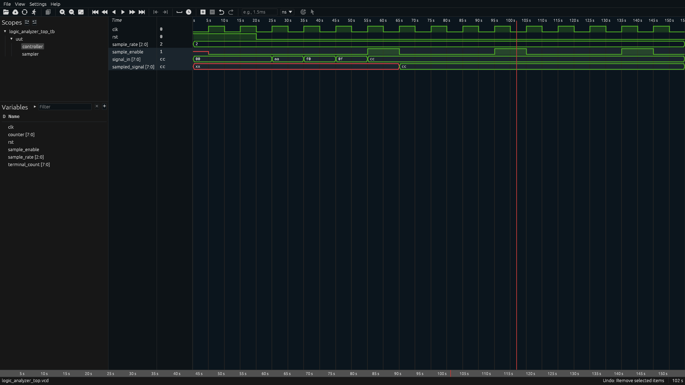

# FPGA Logic & Protocol Analyzer

An 8-channel FPGA logic analyzer built for the **Digilent Basys 3 (Xilinx Artix-7)**, designed to capture, trigger on, and analyze digital signals.

> **Status:** 🚧 FPGA RTL implemented and simulated | Python software and hardware validation in progress

## Overview

I'm developing this project to gain hands-on experience with FPGA development, digital design, RTL verification, and hardware debugging.

The analyzer captures digital signals from microcontrollers, sensors, and other digital hardware, stores samples in FPGA Block RAM, and transfers captured data to a PC through UART for waveform visualization and protocol decoding.

The design targets **8 channels at up to 100 MS/s**, with a **128K-sample capture buffer** and planned support for UART, SPI, and I2C protocol analysis.

## System Architecture

```text
ESP32 / MCU / Sensor
        |
   8 Digital Channels
        |
        v
+----------------------+
|      Basys 3 FPGA    |
|                      |
|   Input Sampler      |
|         |            |
|   Trigger Engine     |
|         |            |
|   Capture FSM        |
|         |            |
|   128K BRAM Buffer   |
|         |            |
|   UART Offload       |
|         |            |
|   UART Transmitter   |
+---------+------------+
          |
       USB/UART
          |
          v
+----------------------+
|          PC          |
|                      |
|   Python Receiver    |
|   Waveform Viewer    |
|   Protocol Decoder   |
+----------------------+
```

## Target Features

- 8 simultaneous digital input channels
- Configurable sampling rates: 100, 50, 25, 10, 5, and 1 MS/s
- 131,072 × 8-bit capture buffer (128K samples)
- Rising/falling-edge and pattern triggering
- Configurable pre/post-trigger capture
- UART-based FPGA-to-PC data transfer
- Python waveform visualization
- UART, SPI, and I2C protocol decoding
- Frequency and pulse-width measurements

Final performance specifications will be determined through FPGA synthesis, timing analysis, and hardware validation.

## Hardware

**Development Board:** Digilent Basys 3  
**FPGA:** Xilinx Artix-7 XC7A35T  
**System Clock:** 100 MHz  
**Test Device:** ESP32

The ESP32 will generate known digital signals and UART/SPI/I2C traffic for hardware validation.

## Development Progress

### Completed — RTL and Simulation

- [x] Define project architecture
- [x] Select FPGA development board
- [x] Implement 8-channel input sampler
- [x] Implement configurable sampling controller
- [x] Implement 128K-sample capture buffer
- [x] Implement trigger engine
- [x] Implement pre/post-trigger capture FSM
- [x] Implement UART transmitter
- [x] Implement UART offload controller
- [x] Simulate capture and trigger integration
- [x] Verify 131,072-byte UART offload controller sequence
- [x] Verify first 16 UART bytes against captured BRAM data

### Remaining

- [ ] Complete full-system verification and edge-case testing
- [ ] Develop Python UART receiver
- [ ] Develop Python waveform viewer
- [ ] Implement UART protocol decoder
- [ ] Implement SPI protocol decoder
- [ ] Implement I2C protocol decoder
- [ ] Add frequency and pulse-width measurements
- [ ] Run Vivado synthesis and timing analysis
- [ ] Configure Basys 3 FPGA pin constraints
- [ ] Validate design on physical Basys 3 hardware
- [ ] Perform hardware performance testing

## Tools

**FPGA:** Verilog/SystemVerilog, AMD Vivado, Artix-7  
**Verification:** Icarus Verilog, Surfer, Verilog testbenches  
**Software:** Python, Git/GitHub  
**Protocols:** UART, SPI, I2C

## Repository Structure

```text
├── rtl/         # FPGA RTL modules
├── tb/          # Verilog testbenches
├── sim/         # Simulation outputs
├── software/    # Python software
├── hardware/    # FPGA pin constraints
├── docs/        # Design documentation
└── images/      # Simulation screenshots
```

## Current Progress

### 1. Configurable 8-Channel Input Sampling

Implemented an 8-bit input sampler controlled by a configurable sampling enable signal.

The sampling controller supports 100, 50, 25, 10, 5, and 1 MS/s using the FPGA's 100 MHz system clock.

The simulation below demonstrates 25 MS/s sampling. Input changes occurring between sampling events are not captured.



### 2. Trigger Engine

Implemented a configurable trigger engine supporting:

- Rising-edge detection
- Falling-edge detection
- Channel selection
- 8-bit pattern matching with a configurable mask

The trigger engine is integrated with the capture controller and has been tested in simulation.

### 3. Capture FSM and BRAM Buffer

Implemented a capture controller using four states:

- **IDLE:** Waits for capture to begin
- **PRE_TRIGGER:** Collects samples before the trigger
- **POST_TRIGGER:** Continues collecting samples after the trigger
- **DONE:** Indicates capture completion

Captured samples are stored in a circular **131,072 × 8-bit memory buffer**.

Integration simulation confirmed that the FSM transitions through capture states, completes the capture sequence, and allows captured data to be read from memory.

### 4. UART Transmitter

Implemented a UART transmitter with:

- Configurable baud rate
- 8-bit data transmission
- Start and stop bits
- Busy and completion signals
- Finite-state-machine-based control

Simulation verified transmission of the test byte `0xA5`, including the start bit, all eight data bits, and stop bit.

### 5. UART Offload Controller

Implemented a controller that sequentially reads samples from the capture buffer and sends them to the UART transmitter.

The controller handles synchronous memory reads, UART handshaking, and circular address wraparound.

Simulation verified the transfer sequence for **all 131,072 bytes** using a simulated UART handshake.

### 6. End-to-End UART Integration

Integrated the capture buffer, UART offload controller, and UART transmitter into the top-level FPGA design.

An end-to-end simulation:

1. Started an 8-channel capture.
2. Generated a rising-edge trigger on channel 3.
3. Waited for capture completion.
4. Started UART offload.
5. Decoded the serial TX output.
6. Compared the first 16 transmitted bytes against the corresponding BRAM contents.

**Result: PASS — All 16 transmitted bytes matched the captured memory data.**

Example simulation output:

```text
PASS: Capture completed
PASS: Byte 0 = 00
PASS: Byte 1 = 00
PASS: Byte 2 = 00
PASS: Byte 3 = 08
PASS: Byte 4 = 08
...
PASS: Byte 15 = 08
PASS: UART end-to-end test completed
```

The transition from `0x00` to `0x08` represents channel 3 changing from LOW to HIGH.

## Next Steps

The next development phase focuses on building the Python receiver and waveform viewer, implementing protocol decoding, and validating the RTL on the Basys 3 using Vivado.

The design has passed initial functional simulations but has not yet been validated through FPGA synthesis, timing closure, or physical hardware testing.
